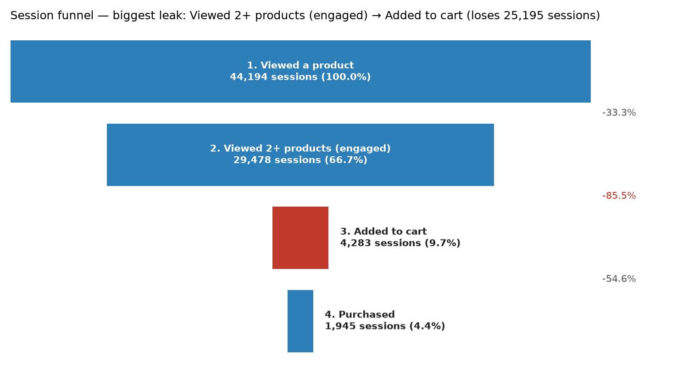

# E-commerce Funnel Drop-off Analysis

**Question:** Where do shoppers leave on the way from viewing a product to buying it, and which step loses the most people?

**Tools:** SQL (SQLite) for the funnel queries, Python to run them, and an Excel workbook with a native funnel chart. The CSV outputs can also go straight into Power BI.



## Key findings

| Step | Sessions | % of top | Step drop-off |
|---|---:|---:|---:|
| 1. Viewed a product | 44,194 | 100.0% | – |
| 2. Viewed 2+ products (engaged) | 29,478 | 66.7% | −33.3% |
| 3. Added to cart | 4,283 | 9.7% | **−85.5%** |
| 4. Purchased | 1,945 | 4.4% | −54.6% |

1. **Engaged browsing → add to cart is the biggest leak.** It loses 25,195 sessions, more than the other two steps combined. Shoppers compare products but don't commit. This is where product pages, pricing, reviews and stock signals should be tested first.
2. **Cart abandonment is also high, at 54.6%.** About half of carts never convert. Abandonment goes up with price: 47.6% under $100 and 64.6% at $800+. That points to price shock and payment friction (instalments, shipping cost shown upfront).
3. **Category matters.** Smartphones, headphones and toys convert at 8–9% overall. Sofas (1.7%), fridges and notebooks (about 3%) leak at both steps, so they are better targets for retargeting and financing offers than for checkout fixes.
4. **Browsing depth predicts intent.** Cart rate climbs from 8.6% for 1-view sessions to about 19% for 5+ views. So "engaged but not carted" sessions are a good retargeting audience.

> The numbers above come from the bundled sample data (see below). Re-run on the real dataset to get production numbers. The SQL doesn't change.

## Dataset

The schema matches the public **REES46 "eCommerce behavior data from multi category store"** clickstream on Kaggle:
<https://www.kaggle.com/datasets/mkechinov/ecommerce-behavior-data-from-multi-category-store>

`event_time, event_type (view | cart | remove_from_cart | purchase), product_id, category_id, category_code, brand, price, user_id, user_session`

The full dataset is many GB and needs a Kaggle login. So `src/make_sample_data.py` builds a reproducible ~143k-event sample in the same schema, and the project runs out of the box. To use the real data, download a month's file (for example `2019-Nov.csv`) into `data/` and pass it with `--csv`.

## How to run

```bash
python3 -m venv .venv && source .venv/bin/activate
pip install -r requirements.txt

python src/make_sample_data.py          # creates data/events_sample.csv
python src/run_analysis.py              # loads into SQLite, runs /sql, writes /output

python test_funnel.py                   # sanity-check the funnel SQL

# real data (cap rows if your machine is small):
python src/run_analysis.py --csv data/2019-Nov.csv --max-rows 5000000
```

## Project structure

```
sql/
  00_session_flags.sql            one row per session with a flag per funnel step (view)
  01_funnel_overall.sql           sessions per step, conversion, drop-off (window functions)
  02_funnel_by_category.sql       funnel split by product category
  03_cart_abandonment_by_price.sql abandonment by carted-item price band
  04_engagement_vs_cart.sql       views per session vs cart / purchase rate
  05_conversion_by_hour.sql       cart and purchase rate by hour the session started
  06_cart_abandonment_by_brand.sql brands with the most carted-but-not-bought items
src/
  make_sample_data.py             sample generator (REES46 schema)
  run_analysis.py                 load -> query -> chart -> Excel
test_funnel.py                    checks the SQL against a tiny hand-built event log
output/
  funnel.png                      funnel chart
  funnel_report.xlsx              one sheet per query + Excel funnel chart
  0*_*.csv                        raw query results (drop into Power BI)
```

## Method notes

- **Unit of analysis is the session** (`user_session`), the standard choice for on-site funnels. User-level funnels would hide repeat visits.
- **The funnel is strict:** a session counts at step N only if it also reached steps 1…N−1. A session that carts after a single product view doesn't count as "engaged", so step 3 is a bit lower than the raw cart count.
- `LAG()` and `FIRST_VALUE()` window functions compute step-to-step and top-of-funnel conversion in one query.
- **Hour of day:** the sample spreads sessions evenly across the day, so `05_conversion_by_hour` comes out flat. On the real REES46 data, use it to time cart-reminder emails and campaigns.
- **Power BI:** load `output/01_funnel_overall.csv` and use the built-in Funnel visual (Category = `step`, Values = `sessions`).
